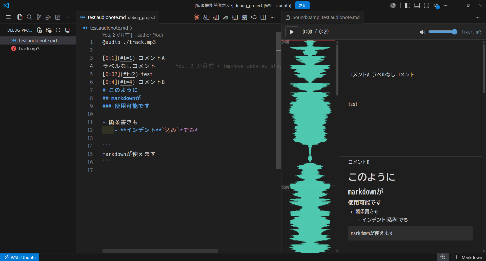

# AudioMD

`.audionote.md` / `.audiomd.md` ファイルの音声同期プレビューを提供する VSCode 拡張機能。



## 機能

- 音声ファイルと Markdown ノートの同期表示
- 縦軸を時間、横軸を周波数（対数軸）とした音声スペクトログラムの描画（ステレオ音源は L・R を左右に並べて表示）
- スペクトログラムのクリック/ドラッグによるシーク
- 右クリック/ドラッグでエディタへタイムスタンプ構文を挿入
- 再生中の自動スクロール

## ファイル形式

拡張子: `*.audionote.md` または `*.audiomd.md`（両方サポート）

```markdown
---
audio: ./track.mp3
---

[0:10](#t=10) コメントA

[1:30](#t=90) コメントB

[1:30-1:45](#t=90,105) 範囲コメント
```

通常の Markdown のスーパーセットのため、既存の Markdown レンダラーでもそのまま開ける。

## 使い方

`.audionote.md` または `.audiomd.md` ファイルをエディタで開き、タイトルバーの「Open AudioMD Preview」ボタン (`$(open-preview)`) をクリック。

### キーボード操作

ノートに対応するプレビューを開いておくと、ノート編集中でもプレビューにフォーカスがあるときでも、次のショートカットを使えます。通常の Markdown や他の画面では有効になりません。

| ショートカット | 操作 |
|---|---|
| `Ctrl+Alt+J` | 5秒戻す |
| `Ctrl+Alt+K` | 再生・一時停止 |
| `Ctrl+Alt+L` | 5秒進む |
| `Ctrl+Alt+I` | 現在の再生位置の時刻リンクをノートのカーソル位置に挿入 |

時刻リンクは既存の右クリック操作と同じ形式で、秒未満を切り捨てます。選択範囲があれば置き換えます。自動保存はしません。音声の読み込み前や読み込み失敗時は操作しません。

コマンドパレットの **AudioMD** コマンドからも実行でき、VS Code の「キーボード ショートカット」でキーを変更できます。

### 旧形式からの移行

0.2.0 から、音声参照は先頭行の `@audio ./track.mp3` ではなく YAML Front Matter の `audio` で指定します。

1. 移行したい `.audionote.md` または `.audiomd.md` をテキストエディタで開きます。
2. コマンドパレットから **AudioMD: Migrate Legacy Audio Reference** を実行します。
3. 先頭行が Front Matter に置き換わったことを確認し、保存します。

変換対象は開いているファイルの先頭行だけです。本文は変更せず、自動保存もしません。Undo で元に戻せます。旧記法がないファイルや移行済みのファイルは変更しません。

## セットアップ

```sh
pnpm install
pnpm build
```

ビルド後、`.vsix` をパッケージして VSCode にインストール:

```sh
pnpm package
```

## 開発

```sh
pnpm watch   # ウォッチビルド
```

Webview のデバッグログは `webview-debug.log` に出力される。

```sh
tail -f webview-debug.log
```
